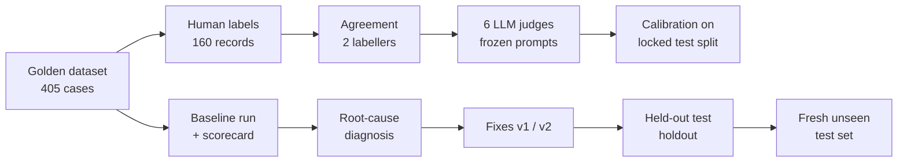

# support-agent-evals

An evaluation pipeline for **GlowCare**, a RAG-based WhatsApp skincare-support agent
(`gemini-3.1-flash-lite`). I used it to measure the agent, find real failures, fix them, and
check the fixes on data the fixes were never written from.

The agent lives in a separate repo; this repo only evaluates it.

## Key results

| What | Result | Source |
|---|---|---|
| **Escalation on held-out data** (172 holdout cases, after = routing rules run offline) | precision **27.2% → 92.0%** (false alarms **59 → 2**), recall 78.6% → 82.1% | [reports/agent_fix_v1.md](reports/agent_fix_v1.md) |
| **Run-to-run noise** (unchanged agent, temperature 0, two runs on 96 dev cases) | **0** changed routes, escalations or replies, so every dev change is the fix | [reports/agent_fix_v1.md](reports/agent_fix_v1.md) |
| **Routing on 50 fresh, unseen cases** (original → v1 → v2) | **44.0% → 54.0% → 68.0%**; 0 cases broken by v2; about 80% of v2's holdout gain carried over | [reports/fresh_v2_eval.md](reports/fresh_v2_eval.md) |
| **LLM judges vs human labels** (locked test split, 64 cases, Gwet's AC1) | relevance 0.78, completeness 0.93, safety 1.00, tone 0.81, faithfulness 1.00, correctness 0.85 | [reports/judges/FINAL_test_v1.md](reports/judges/FINAL_test_v1.md) |
| **Judge bias tests** (filler, authority claim, bullets, prompt injection, chunk order) | 5 of 269 perturbed verdicts went fail → pass, none clearly caused by the perturbation; the injection note gave 1 flagged fail → pass, on a case that also flipped under harmless edits | [reports/judges/bias_tests_v1.md](reports/judges/bias_tests_v1.md), [notes/day22.md](notes/day22.md) |

## How it works



## What I did

1. **Dataset.** I built 405 test cases from a legacy sheet, known bugs and reviewed synthetic
   cases, versioned in `datasets/MANIFEST.json`. They are split by case into dev (96), test
   (64, locked) and holdout (245, everything else). See [notes/day13_split.md](notes/day13_split.md).
2. **Human labels.** A local Streamlit labelling app, rubric v4 with 7 criteria, and 160
   labelled records. Two labellers overlapped on 50 records: escalation κ 0.87 / AC1 0.94,
   tone AC1 0.72. Cohen's kappa and Gwet's AC1 come with 95% bootstrap CIs. See
   [reports/human_agreement.md](reports/human_agreement.md).
3. **Deterministic metrics.** Routing, escalation, database facts, voice, content rules,
   latency and tokens. The Day 21 baseline: routing 72.1%, escalation recall 81.0% and
   precision 27.4% (380 cases). See [notes/day21_baseline.md](notes/day21_baseline.md).
4. **LLM judges.** Six judges (OpenAI `gpt-5-mini`), one per criterion, built from the rubric
   files. I tuned them on dev only, then **froze** them and evaluated them once on the locked
   test split. See [reports/judges/FINAL_test_v1.md](reports/judges/FINAL_test_v1.md).
5. **Synthetic negatives.** Template edits of dev replies, to measure how often the judges
   catch failures: faithfulness 20/20, correctness 11/11, safety 14/15, tone 12/15
   (completeness 1/2). See [reports/judges/synthetic_negatives_v1.md](reports/judges/synthetic_negatives_v1.md).
6. **Bias tests.** Meaning-preserving template perturbations, checking whether judges flip
   their verdict. See [reports/judges/bias_tests_v1.md](reports/judges/bias_tests_v1.md).
7. **Tracking.** Scored runs and evaluations (baseline, agent fix, bias tests, fresh set) are
   logged to MLflow, locally in `./mlruns`.
8. **Diagnosis.** One rule caused 16 of 19 dev false alarms: every "not found" answer was
   escalated. Keyword routing missed greetings, prompt injections and medical questions. See
   [notes/day25_phaseA_diagnosis.md](notes/day25_phaseA_diagnosis.md).
9. **Fix v1** (9 general rules, plus temperature 0): on dev, routing went 69.6% → 96.7% and
   escalation precision 26.9% → 100%. Dev is optimistic, because the rules were written from
   dev errors. Holdout is the honest number: routing 72.8% → 78.1%. See
   [reports/agent_fix_v1.md](reports/agent_fix_v1.md).
10. **Fix v2** (written from holdout's remaining failure types), then tested on a **fresh set
    written after v2 was committed** and never seen while writing it: 68.0% routing. See
    [reports/fresh_v2_eval.md](reports/fresh_v2_eval.md), [notes/day26_v2_router.md](notes/day26_v2_router.md).

## How I kept it honest

- **Separate splits:** dev for building, a test split that was **locked** (loading it needs a
  code flag, a reason and an environment variable, and each access is logged in
  `reports/test_access.log`), and a holdout that no labelled split touches.
- **Frozen judge prompts** (`prompts/judges/FROZEN.json`), evaluated once on test. After that
  run the test split counts as used.
- **A noise check before claiming improvement:** two identical temperature-0 runs gave the
  same replies, so dev changes can't be noise.
- **Holdout once per fix:** v1 was scored on holdout once. v2 was written from holdout's
  failures, so I report its holdout score as **optimistic**.
- **A fresh, unseen set for v2,** written only after v2 was committed. **No rule was changed
  after seeing those results**; the misses are listed as limitations.
- **Overfitting measured, not assumed:** v2 drops 27.6 points from holdout to fresh, but v1
  (never fitted to holdout) drops 24.1, so most of the gap is a harder set. v2's gain over v1
  shrank from +17.5 to +14.0 points. See [reports/fresh_v2_eval.md](reports/fresh_v2_eval.md).
- **Paid or rate-limited calls** always get a dry run, a call cap and a clean stop on
  quota or rate-limit errors.

## Limitations

- **The live holdout run is partial** (51 of 235 answered), stopped by repeated Gemini 503s
  and low memory. The offline holdout numbers matched all 51 live cases, and routing and
  escalation after the fix don't depend on the LLM, so they are exact; answer wording is not
  covered. See [reports/agent_fix_v1.md](reports/agent_fix_v1.md).
- **Tone was not bias-tested** (the OpenAI credits ran out mid-run). The tone judge is also
  over-strict on test: 12 judge fails vs 2 human fails. See [notes/day22.md](notes/day22.md),
  [reports/judges/FINAL_test_v1.md](reports/judges/FINAL_test_v1.md).
- **Small sets give wide CIs:** about ±14 points on the 50-case fresh set, and fails are rare
  for several criteria.
- **The fresh set has 2 possible label issues:** a product not in the catalogue, and a size
  question the product data can't answer.
- **Keyword guardrails don't generalise:** v2 caught only **1 of 7** new attack styles in the
  fresh set.
- **The bot always replies in English,** even to Roman Urdu messages. Nothing in the agent's
  rules or code handles reply language, and no metric scores it.
- **Relevance is the weakest judge** (AC1 0.78 on test).
- **One agent model and one labelled sample.** Answer quality after the fixes has not been
  re-judged.

## Future work

- A **semantic / LLM guardrail classifier** (v3) instead of more keywords.
- **Reply-language matching** (answer Roman Urdu in Roman Urdu), plus a rubric line for it.
- A **larger fresh test set** for tighter CIs.
- **Re-judge answer quality** after the fixes; the edited prompt rules changed the wording of
  some answers.

## Tech stack

Python 3.11, uv, Typer and Pydantic, Streamlit (labelling app), MLflow (tracking, SQLite in
`./mlruns`), OpenAI `gpt-5-mini` (judges), Gemini `gemini-3.1-flash-lite` (the agent), pytest
and Hypothesis with coverage gates (100% for data contracts, 90% for runtime), ruff, mypy
`--strict`, and GitHub Actions CI.

## How to run

Setup, once:

```powershell
uv sync                         # add --group labeling for the Streamlit app
copy .env.example .env          # then fill in AGENT_URL, AGENT_API_KEY (and OPENAI_API_KEY for judges)
```

Tests and lint (no agent or API needed):

```powershell
.\scripts\tasks.ps1 test        # pytest + coverage gates   (make test on Linux/macOS)
.\scripts\tasks.ps1 lint        # ruff + mypy --strict
```

Evaluate the agent. Start the agent first (separate repo):

```powershell
uv run evalkit health                                   # agent reachable, key works
uv run evalkit run --dataset datasets/sample_5.jsonl    # a 5-case smoke run
uv run evalkit agent-budget                             # dry run: predicted LLM calls, no call
uv run evalkit report --run <run_id>                    # scorecard of a scored run
uv run evalkit compare <run_a> <run_b>                  # deltas with paired bootstrap CIs
```

Offline, no agent and no API (needs the agent repo next to this one):

```powershell
uv run python scripts/eval_fresh_routing.py --no-mlflow   # routing on the fresh set, 3 versions
uv run python scripts/compare_routers.py out.json         # v1 vs v2 on dev, holdout, agent sheet
```

Labelling app and MLflow UI:

```powershell
.\scripts\tasks.ps1 label -Labeler <name>
uv run mlflow ui --backend-store-uri sqlite:///mlruns/mlflow.db
```

## Repo map

| Path | What |
|---|---|
| `datasets/` | test cases (`golden_v1.2.jsonl`), human labels, splits (`splits/`), fresh set (`fresh_v2.jsonl`), `MANIFEST.json` |
| `rubrics/` | the 7-criterion labelling rubric (v4) and its version history |
| `prompts/judges/` | judge prompts per version; `FROZEN.json` pins the final ones |
| `reports/` | every result cited above; `reports/judges/` for judge calibration and bias |
| `notes/` | day-by-day notes: decisions, numbers and limitations |
| `src/evalkit/` | the pipeline (runner, metrics, judges, calibration, bias, tracking) |
| `app/labeler.py` | the Streamlit labelling app |
| `scripts/` | task runner and offline evaluation scripts |
| `tests/` | pytest suite (no network) |
| `agent_snapshot/` | read-only copy of the agent's routing code and data at the Day 7 commit |
